<p align="left" style="font-size:28px;"><strong><em>Documentação do PI — P.I Hub</em></strong></p>

**Gestão centralizada e histórico dos Projetos Integradores (PIs)**
Fatec Jahu · Curso de Desenvolvimento de Software Multiplataforma · Equipe04

<details>

  <summary><strong>📑 Sumário</strong></summary>

- [1. Introdução](#1-introdução)
  - [Objetivos](#-objetivos)
  - [Metodologia](#-metodologia)
- [2. Requisitos](#2-requisitos)
  - [Requisitos funcionais](#-requisitos-funcionais)
  - [Requisitos não funcionais](#-requisitos-não-funcionais)
- [3. Modelo de casos de uso](#3-modelo-de-casos-de-uso)
- [4. Modelo do banco de dados](#4-modelo-do-banco-de-dados)
- [5. Banco de dados](#5-banco-de-dados)
- [6. Diagrama de classes](#6-diagrama-de-classes)
- [7. Estudo de viabilidade](#7-estudo-de-viabilidade)
- [8. Regras de negócio (Modelo canvas)](#8-regras-de-negócio-modelo-canvas)
- [9. Design](#9-design)
- [10. Protótipo](#10-protótipo)
- [11. Aplicação](#11-aplicação)
- [12. Considerações finais](#12-considerações-finais)
- [13. Referências](#13-referências)

</details>

---

# 1. Introdução

Atualmente, o acompanhamento dos Projetos Integradores (PIs) desenvolvidos ao longo do curso é fragmentado: informações sobre grupos, temas, integrantes, disciplinas envolvidas e entregas ficam espalhadas em fontes diferentes (por exemplo, planilhas), sem um histórico organizado das mudanças ocorridas durante o semestre. Isso torna o trabalho da coordenação mais lento, pois é preciso navegar projeto a projeto para entender o status de cada grupo e o que mudou ao longo do tempo.

A justificativa do **P.I Hub** parte dessa dificuldade prática, vivenciada pelos próprios autores como alunos do curso. A proposta é oferecer uma ferramenta simples que centralize essas informações em um único lugar, reduzindo o tempo gasto na busca por dados, tornando a evolução de cada PI mais visível e servindo como vitrine dos principais projetos da Fatec Jahu.

## • Objetivos

**Objetivo geral:** desenvolver uma aplicação web que centralize e organize a visualização de todos os Projetos Integradores do curso, permitindo à coordenação acompanhar a evolução dos grupos, temas e entregas ao longo dos semestres.

**Objetivos específicos:**

- Organizar os projetos por semestre, PI, grupo responsável, disciplinas envolvidas, tema e integrantes;
- Exibir uma linha do tempo com o histórico das principais mudanças de cada PI (troca de integrantes, alteração de tema, atualização de entregas);
- Disponibilizar conteúdo institucional (sobre o curso, a Fatec, Manual do PI) e uma visão resumida dos principais projetos para divulgação;
- **Fase atual (MVP):** apenas **visualização com dados mockados**. Login, cadastros/edições e integração com backend ficam para as próximas etapas.

## • Metodologia

- **Levantamento de requisitos:** reunião e anotações com o coordenador do curso; entrevista com o diretor prevista (15 a 20 min) para entender suas expectativas.
- **Organização da equipe:** Utilizamos o trello para documetar o processo de criação do projeto e utilizamos o SCRUM como método de desenvolvimento ágil;
- **Documentação:** documento do PI está em PDF neste repositório na pasta [`docs/`](./docs).
- **Tecnologias (front-end):** React (Vite). utilizando Tailwind css. Backend e banco de dados ainda não definidos.
- **Qualidade de código:** ESLint + Prettier.
- **Design:** protótipo no Figma, com identidade visual baseada nas cores do Centro Paula Souza/Fatec.

---

# 2. Requisitos

<!-- > Documento de requisitos: descreve o que o sistema deve fazer (requisitos funcionais) e com que qualidade (requisitos não funcionais), servindo de acordo entre equipe e interessados.
> Os RF abaixo são o **pós-entrevista com o coordenador**, organizados em grupos e com cada operação (cadastrar, editar, arquivar) como um RF próprio. O escopo do documento é amplo; o MVP implementa apenas parte deles. -->

## • Requisitos funcionais

<!-- > A numeração abaixo foi reorganizada em relação ao rascunho anterior (RF1–RF9). -->

### Grupo 1 — Disciplinas

| ID   | Requisito                                           | MVP?             |
| ---- | --------------------------------------------------- | ---------------- |
| RF01 | Listar disciplinas do curso e as relacionadas ao PI | ✅               |
| RF02 | Cadastrar disciplina                                | ❌ próxima etapa |
| RF03 | Editar disciplina                                   | ❌ próxima etapa |
| RF04 | Arquivar disciplina                                 | ❌ próxima etapa |

### Grupo 2 — PIs

| ID   | Requisito                                                                                                                                                                                                                                                                                             | MVP?      |
| ---- | ----------------------------------------------------------------------------------------------------------------------------------------------------------------------------------------------------------------------------------------------------------------------------------------------------- | --------- |
| RF05 | Listar PIs, com alunos, responsáveis e temas                                                                                                                                                                                                                                                          | ✅        |
| RF06 | Visualizar detalhes do PI, incluindo linha do tempo e observação                                                                                                                                                                                                                                      | ✅        |
| RF07 | Cadastrar PI: título, descrição, membros/função, semestre, ano de ingresso, link do YouTube, repositório GitHub (aluno e Fatec), categoria/área, status (Em andamento / Concluído / Trancado / Cancelado), professor orientador, imagem de capa; data de criação e última atualização são automáticas | ❌ futuro |
| RF08 | Editar dados do PI (aluno responsável)                                                                                                                                                                                                                                                                | ❌ futuro |
| RF09 | Arquivar PI (não há exclusão, as informações são mantidas)                                                                                                                                                                                                                                            | ❌ futuro |

### Grupo 3 — Atualizações do PI (linha do tempo)

| ID   | Requisito                                                                                          | MVP?      |
| ---- | -------------------------------------------------------------------------------------------------- | --------- |
| RF10 | Cadastrar atualização do PI: descrição, data automática, imagem, tags (apenas o aluno responsável) | ❌ futuro |
| RF11 | Editar atualização do PI (aluno responsável)                                                       | ❌ futuro |
| RF12 | Arquivar atualização do PI                                                                         | ❌ futuro |

### Grupo 4 — Usuários e acesso

| ID   | Requisito                                                                                                                           | MVP?      |
| ---- | ----------------------------------------------------------------------------------------------------------------------------------- | --------- |
| RF13 | Login com 3 perfis: Coordenador (nível mais alto), Professor (abaixo do Coordenador) e Aluno responsável pelo PI (nível mais baixo) | ❌ futuro |
| RF14 | Criar contas de usuário (Coordenador e Professor)                                                                                   | ❌ futuro |

### Grupo 5 — Consulta e relatórios

| ID   | Requisito                                      | MVP?      |
| ---- | ---------------------------------------------- | --------- |
| RF15 | Buscar PIs por semestre / semestre de ingresso | ❌ futuro |
| RF16 | Emitir relatórios (Coordenador e Professor)    | ❌ futuro |

### Grupo 6 — Conteúdo institucional

| ID   | Requisito                                                                                                                                                                  | MVP? |
| ---- | -------------------------------------------------------------------------------------------------------------------------------------------------------------------------- | ---- |
| RF17 | Exibir conteúdo institucional estático: sobre o curso, sobre a Fatec (ou link para o site), Manual do PI, matérias do curso e página com as disciplinas relacionadas ao PI | ✅   |

### Grupo 7 — Avaliação do PI

| ID   | Requisito                                                                                                                           | MVP?       |
| ---- | ----------------------------------------------------------------------------------------------------------------------------------- | ---------- |
| RF18 | Registrar avaliação do PI pela banca (dados da equipe, autoavaliação, avaliação do trabalho escrito, da apresentação e da entidade) | ❌ roadmap |

**Observações:**

- Todos os perfis têm acesso de visualização aos PIs.
- A observação do PI é visível a todos os usuários autenticados.
- Diferenças de permissão entre Coordenador e Professor serão definidas futuramente.
- Hierarquia: **Semestre > PIs > Grupo responsável**. Cada PI pertence a um único grupo, mas um grupo pode ter um ou mais PIs.
- Nenhum registro é excluído: o sistema apenas arquiva.

## • Requisitos não funcionais

- **Produto:** interface responsiva e de navegação simples, com carregamento rápido das listagens.
- **Organização:** desenvolvimento versionado no GitHub; tarefas gerenciadas no Trello.
- **Confiabilidade:** a aplicação não deve expor dados pessoais reais de alunos nesta fase (dados mockados, por proteção de dados).
- **Implementação:** React (Vite) no front-end, com ESLint e Prettier.
- **Padrões:** identidade visual do CPS/Fatec.
- **Interoperabilidade:** previsão de importação de dados existentes (planilhas/CSV) em fase futura.

---

# 3. Modelo de casos de uso

_Pendente_

---

# 4. Modelo do banco de dados

_Pendente_ (modelo conceitual, lógico e físico)

---

# 5. Banco de dados

_Pendente._ Nesta fase, a aplicação usa dados mockados; a escolha do SGBD e do backend ainda não foi feita.

---

# 6. Diagrama de classes

_Pendente_

---

# 7. Estudo de viabilidade

Estudo enquadrado como se o P.I Hub fosse uma empresa. **Conclusão: viável como MVP.** A versão completa só deve começar após validação do MVP com usuários reais.

| Seção           | Responsável          | Resumo                                                                                                                                                                                                                                                                                                    |
| --------------- | -------------------- | --------------------------------------------------------------------------------------------------------------------------------------------------------------------------------------------------------------------------------------------------------------------------------------------------------- |
| 7.1 Técnica     | Bruno                | Front-end de visualização com dados mockados. Stack gratuita (React, Vite, Tailwind, JSON local, Git/GitHub) e hospedagem estática. Riscos: prazo curto entre o design (28/10) e a entrega (18/11), experiência variável com React, conflitos de código e mock diferente do futuro back-end.              |
| 7.2 Financeira  | Adrian               | MVP: 160 h × R$ 25 = R$ 4.000 e R$ 54,17/mês. Versão completa: 400 h = R$ 10.000 e R$ 164,17/mês. Benefício de custo evitado estimado em R$ 2.000/semestre (hipótese a validar), com retorno do MVP em cerca de 2,4 semestres. Cenário comercial é só simulação (equilíbrio com 2 clientes a R$ 100/mês). |
| 7.3 Mercado     | Eliandro             | O concorrente real é a planilha de Excel. Trello, Notion, GitHub Classroom, SIGA e Google Classroom não cobrem visão por semestre/grupo nem histórico dos PIs. Principal risco: adoção. Potencial de replicação nas Fatecs, começando por piloto.                                                         |
| 7.4 Operacional | Paulo                | Uso simples, sem treinamento formal. Implantação gradual no DSM, com trabalho inicial de migrar a planilha. Depende de a Fatec indicar responsáveis pelos dados.                                                                                                                                          |
| 7.5 Conclusão   | Paulo (consolidação) | Viável como MVP; versão completa exige back-end, custa mais e depende de validação.                                                                                                                                                                                                                       |

O texto completo está no PDF [`docs/Documentação do P.I`](./docs).

---

# 8. Regras de negócio (Modelo canvas)

### Regras do sistema

- Cada PI pertence a um único grupo; um grupo pode ter mais de um PI.
- Hierarquia: **Semestre > PIs > Grupo responsável**.
- Nenhum registro é excluído: o sistema apenas **arquiva**, preservando o histórico.
- Visitante vê apenas dados públicos: não vê o RA dos integrantes nem a Observação do PI.
- O RA é privado e visível apenas a Coordenador e Professor.
- A Observação é visível apenas a usuários autenticados.
- O aluno responsável só edita o próprio PI e cadastra atualizações apenas nele; o Professor, nos PIs sob sua responsabilidade; o Coordenador, em todos.
- Cadastros de disciplinas, PIs, grupos, semestres e usuários são feitos por Coordenador e Professor.
- Datas de criação e de última atualização do PI são automáticas.
- Diferenças de permissão entre Coordenador e Professor ainda serão definidas.

### Modelo de negócios (Canvas)

O Canvas é tratado como hipótese, revisado conforme entrevistas, testes e opiniões dos usuários.

| Bloco                 | Descrição                                                                                                                                                            |
| --------------------- | -------------------------------------------------------------------------------------------------------------------------------------------------------------------- |
| Segmentos de clientes | Alunos, professores orientadores e coordenações da Fatec. Futuramente, outras Fatecs e instituições com projetos semelhantes.                                        |
| Proposta de valor     | Centralizar grupos, temas, integrantes, disciplinas, entregas e histórico de mudanças. Diferencial: ser voltado ao PI, e não uma ferramenta genérica como planilhas. |
| Canais                | Plataforma web; apresentações em sala, demonstrações, comunicação institucional e indicações.                                                                        |
| Relacionamento        | Orientações de uso, tutoriais, suporte e coleta de sugestões.                                                                                                        |
| Fontes de receita     | Nenhuma assumida. Projeto-piloto gratuito; apoio institucional, editais ou licenciamento dependem de validação.                                                      |
| Recursos principais   | Aplicação web, banco de dados, hospedagem, equipe, documentação e participação dos usuários nos testes.                                                              |
| Atividades principais | Desenvolver e testar, administrar acessos, manter segurança e disponibilidade, corrigir falhas, dar suporte e melhorar o produto.                                    |
| Parcerias principais  | Fatec, coordenações, professores orientadores e alunos. Hospedagem ou apoio técnico, se necessário.                                                                  |
| Estrutura de custos   | Tempo de desenvolvimento, hospedagem, domínio, armazenamento, manutenção, suporte e segurança. No protótipo, recursos gratuitos ou de baixo custo.                   |

---

# 9. Design

Tema escuro, com vermelho como cor primária (identidade CPS/Fatec).

### Paleta de cores

| Cor                    | Hex       | Uso                                             |
| ---------------------- | --------- | ----------------------------------------------- |
| Fundo                  | `#0F1115` | Fundo das telas                                 |
| Superfície             | `#171A21` | Cards e painéis                                 |
| Superfície elevada     | `#20242D` | Hover de botões discretos e estado desabilitado |
| Borda                  | `#2B303B` | Contornos e divisórias                          |
| Texto principal        | `#E8EAED` | Títulos e corpo de texto                        |
| Texto secundário       | `#9AA1AE` | Textos de apoio e estado desabilitado           |
| Primária               | `#B51F32` | Botão primário (padrão)                         |
| Primária: hover        | `#D02A40` | Botão primário com o ponteiro sobre ele         |
| Primária: escura       | `#8A1726` | Botão primário pressionado                      |
| Vermelho para texto    | `#E5596B` | Rótulo de botões de contorno e discretos        |
| Verde-azulado (acento) | `#34B3A0` | Acento da interface                             |
| Status: Em andamento   | `#4C8DFF` | Status do PI                                    |
| Status: Concluído      | `#3FB950` | Status do PI                                    |
| Status: Trancado       | `#E3A92B` | Status do PI                                    |
| Status: Cancelado      | `#6B7280` | Status do PI                                    |

### Tipografia

JetBrains Mono é a **família única** da interface (títulos, corpo, navegação, botões, campos e metadados).

| Peso          | Uso                                                     |
| ------------- | ------------------------------------------------------- |
| 400 (Regular) | Corpo de texto, descrições, labels e campos             |
| 500 (Medium)  | Subtítulos, botões, ações e textos de apoio             |
| 700 (Bold)    | Títulos principais, destaques, navegação e ações fortes |

Também usada em identificadores técnicos: RA (`241234-5`), datas (`14/03/2026`) e tags (`#PI-2026`).

### Botões

3 variações × 4 estados. Altura 48 px, raio 8 px, margem interna horizontal 22 px, largura mínima 164 px, rótulo em JetBrains Mono 500 (14/20), formato verbo + objeto.

| Variação              | Padrão            | Hover                        | Pressionado  | Desabilitado       |
| --------------------- | ----------------- | ---------------------------- | ------------ | ------------------ |
| Primário              | Primária          | Hover                        | Escura       | Superfície elevada |
| Secundário (contorno) | Borda primária    | Borda em vermelho para texto | Borda escura | Borda `#2B303B`    |
| Discreto              | Sem preenchimento | Superfície elevada           | Fundo        | Texto secundário   |

Regra de uso: um botão primário por contexto, combinado com secundário ou discreto. No estado desabilitado o vermelho dá lugar ao texto secundário.

### Logo



### Wireframes

- **Wireframes:** (Está em [Protótipo](#10-protótipo))

Seis telas prototipadas no Figma:

| Tela                 | Finalidade                                                         | RF                   | Escopo               |
| -------------------- | ------------------------------------------------------------------ | -------------------- | -------------------- |
| Institucional/Início | Ponto de entrada: apresentação do P.I Hub e conteúdo institucional | RF29 a RF31          | MVP                  |
| Login                | Acesso de Coordenador, Professor e Aluno responsável               | RF23                 | Fase 2 (prototipada) |
| Dashboard ADMIN      | Visão gerencial do Coordenador                                     | RF27 _(a confirmar)_ | Fase 2 (prototipada) |
| Explorar projetos    | Lista os PIs para consulta                                         | RF05                 | MVP                  |
| Projeto detalhes     | Dados do PI, grupo, integrantes, disciplinas e linha do tempo      | RF06 e RF07          | MVP                  |
| Cadastrar projeto    | Formulário de cadastro de PI                                       | RF08                 | Fase 2 (prototipada) |

### Modelo de navegação

```
Home ──► Explorar PIs ──► Detalhe do P.I (linha do tempo)      (sem login)
Home ──► Login (aluno e admin na mesma tela)
           ├─ Aluno ──► Alterar informação do PI ──► Cadastrar atualização ──► Detalhe do P.I
           └─ Admin ──► Dashboard Admin ──► Cadastrar PI ──► Alterar informação do PI
```

---

# 10. Protótipo

Telas prototipadas no Figma até o momento: Institucional/Início, Login, Dashboard Admin, Explorar projetos, Projeto detalhes e Cadastrar projeto.

[Acessar protótipo no Figma](https://www.figma.com/design/QsB2He9AJsyCDJTNbQsiu3/P.i_HUB?node-id=0-1&t=JzNuKREdoajqhVaS-1)

---

# 11. Aplicação

_Em desenvolvimento_

- **Stack:** React (Vite); biblioteca de estilo em definição
- **Fase atual:** somente visualização
- **Escopo do MVP:** RF01, RF05, RF06 e RF17

### Estrutura do repositório

```
/
├── frontend/   # aplicação React (Vite)
├── docs/       # Documentação completa em PDF
└── README.md
```

### Como executar

```bash
cd frontend
npm install
npm run dev
```

---

# 12. Considerações finais

_Pendente_

<!-- *A preencher ao final do semestre.* Pontos já observados: dados reais de PIs não estão disponíveis à equipe por proteção de dados (uso de mocks); o escopo de requisitos é mais amplo que o MVP; backend ainda indefinido. -->

---

# 13. Referências

_A preencher._
